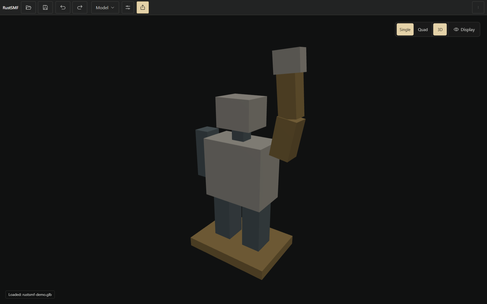

# RustSMF

RustSMF is a local editor for SMF, GLB/GLTF, FBX, DAE/Collada and OBJ models, rigs, animation and skin weights. Files stay on your machine.



## Windows preview

The **0.2.1 Windows preview** targets Windows x64. Build its NSIS installer with PowerShell 7:

```powershell
pwsh -NoProfile -File .\run.ps1 -Task package:windows
```

The command reports the installer path and SHA-256. Install the resulting `RustSMF_0.2.1_x64-setup.exe`, then launch RustSMF from its shortcut. WebView2 is required; the installer handles the configured bootstrapper. The installer is unsigned. See [preview notes](docs/user/PREVIEW_0_2_1.md) for the verified workflows and limits. No public release download is published yet.

## Try it

1. Open [the included Signal Robot](examples/rustsmf-demo.glb), or drop a supported model into the viewport. Select sidecars together when a model needs them.
2. Drag to orbit, right-drag to pan, and scroll to zoom. Choose **Animate**, open **Tools**, and preview **Wave** or **Turn**.
3. **Save Project** keeps your editable model, clips, rig metadata and supported workspace state. **Export** writes a model for another tool. More offers explicit formats and offline Help.

The sample is project-generated and MIT licensed. It has five bones, two two-second clips and three materials, with no external texture or asset dependency.

## Formats and practical limits

Imports: **SMF, GLB/GLTF, FBX, DAE/Collada and OBJ**. Exports: **SMF, GLB, FBX and DAE**.

Supported geometry, skeletons and clips have automated round-trip coverage. GLB is the self-contained texture path. SMF cannot store scale animation; DAE export keeps external textures external. Duplicate GLB node names can change to keep animation bindings unambiguous. Unsupported structures and missing resources produce diagnostics; arbitrary third-party assets can exceed these supported contracts.

See the [user guide](docs/user/README.md) and [current format limits](docs/dev/APP_STATE.md#current-limits).

## Run from source

Use PowerShell 7, the declared Node range (`^22.13.0 || >=24`), Rust and the [Tauri Windows prerequisites](https://v2.tauri.app/start/prerequisites/):

```powershell
pwsh -NoProfile -File .\run.ps1 -Task setup
pwsh -NoProfile -File .\run.ps1 -Task run
```

`run.ps1 -Task dev` opens the browser development shell. The frontend uses React/TypeScript and Three.js; the desktop boundary uses Rust/Tauri.

## Contribute and report problems

[Contributing](CONTRIBUTING.md) covers setup, local checks and a useful bug report. [Frontend evidence](source/frontend/tests/README.md#supported-feature-evidence-matrix) maps supported workflows to executable checks. Maintainer state, work records and verification history live in [developer docs](docs/dev/README.md).

## License

Project-owned code and the Signal Robot sample are [MIT licensed](LICENSE), copyright 2026 Shoozes. Third-party code, fixtures and reference assets retain their own terms. [Third-party notices](THIRD_PARTY_NOTICES.md) and [fixture provenance](source/frontend/tests/fixtures/PROVENANCE.md) describe that boundary; unidentified assets receive no new reuse grant.
