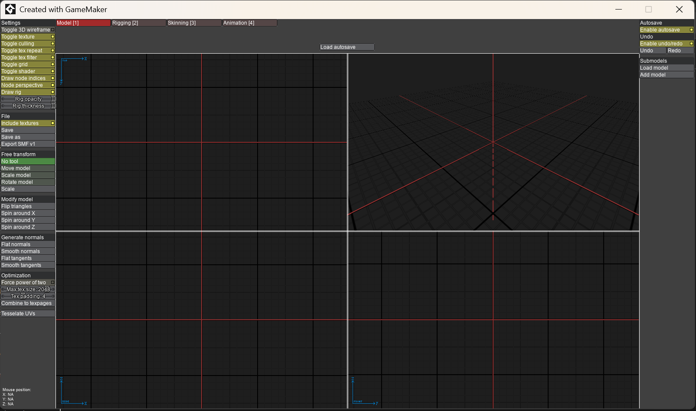
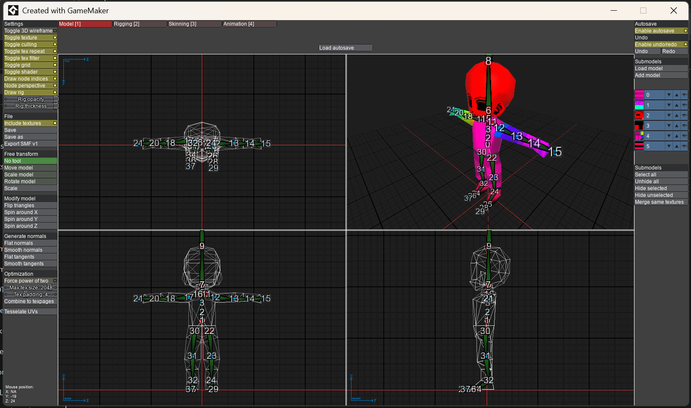
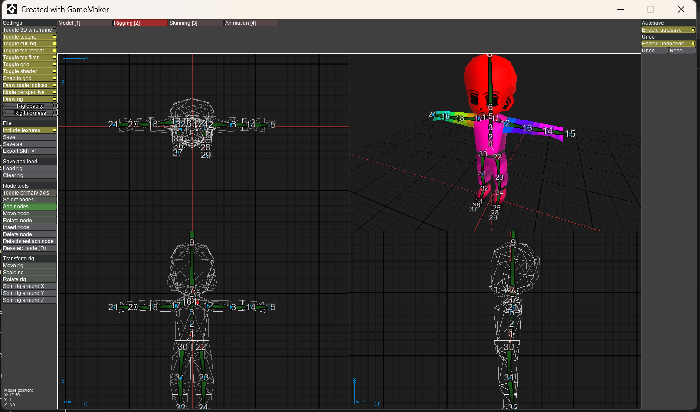
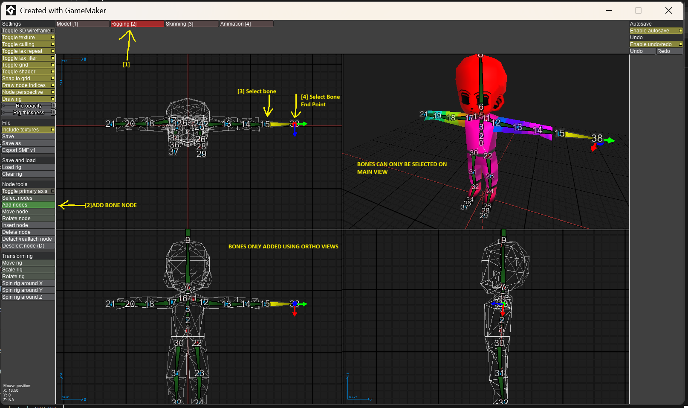
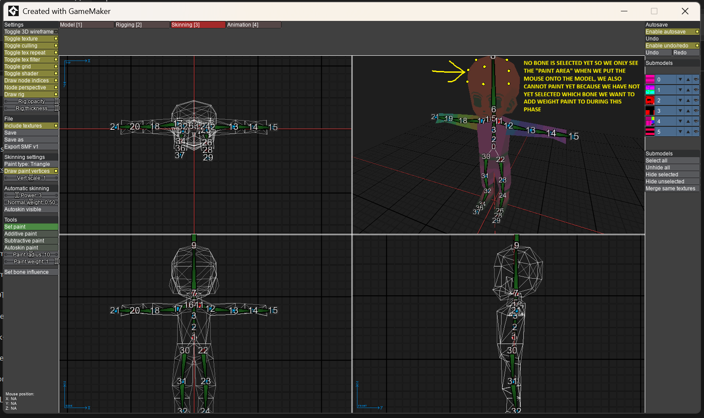
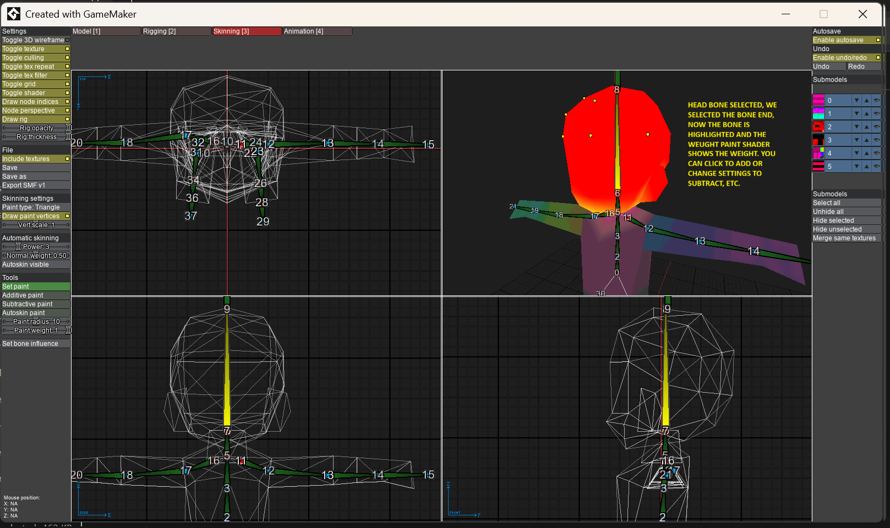
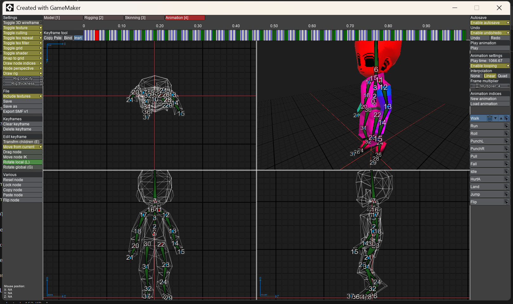
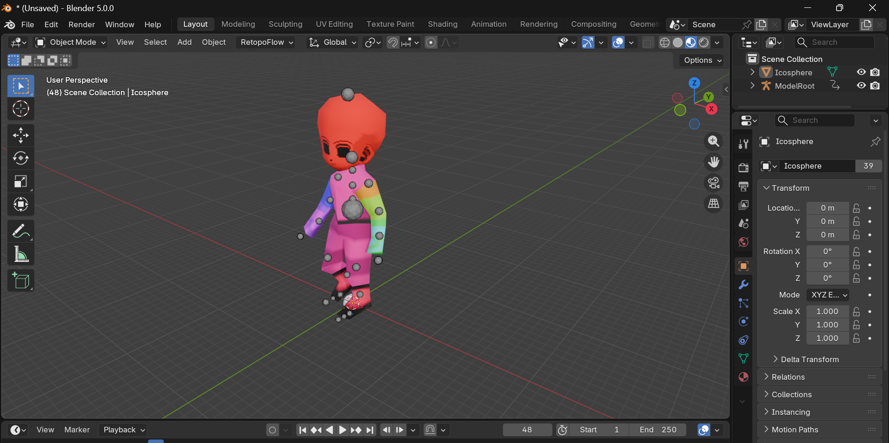

# SMF Editor (Original GameMaker) - Screenshot Analysis

Purpose: Document the exact layout, UI shape, panels, tabs, tools, and interaction patterns from the original SMF Editor (built in GameMaker) for accurate historical reference and comparison against the modern RustSMF reimplementation (Tauri + React + Three.js viewport + separate panels).

All screenshots show the classic "Created with GameMaker" desktop window chrome.

## Common Layout (all images)
- Title bar: "Created with GameMaker"
- Top tab bar (mode switcher): Model [1] | Rigging [2] | Skinning [3] | Animation [4] (active tab highlighted red).
- Left sidebar (scrollable):
  - Many toggle checkboxes (3D wireframe, texture, cutting, repeat, tex filter, grid, shader, draw node indices, perspective, node opacity, rig opacity/thickness, etc.).
  - File section: Include textures, Save/Save as, Export SMF v1.
  - Transform section: Free transform, Move/Scale/Rotate model, Modify model (flip triangles, spin around axes).
  - Optimization + Tessellate UVs.
  - Mode-specific tools appear lower (e.g. node tools, paint tools, keyframes).
- Central viewport: 2x2 split (four panes) — typical ortho front/side + perspective/main views. Dark grid floor, prominent red crosshair axes (X/Y/Z), model overlaid with bone numbers and colored wireframes/rigs in relevant tabs.
- Right sidebar:
  - Autosave dropdown + Undo/Redo stack (shows multiple levels).
  - "Submodels" list with numbered color swatches (0, 1, 2... with RGB indicators).
  - Action buttons: Select all, Undo selected, Hide selected, Merge same textures, Load model, Add model.
- Bottom status bar: Mouse position readouts (X / Y / Z, often N/A or numeric coords when hovering model).
- Yellow arrows + explanatory callout boxes appear in several "how-to" shots to document workflows.

## smf_editor_front.png

Base/empty state (Model tab active, no or minimal model loaded).
- Shows default left tool list in full (general toggles + file/export/transform/optimization).
- Central 4-pane view empty except grid + red axes.
- Right Submodels panel ready for Load model / Add model.
- Represents the starting UI before any SMF or model is imported.

## smf_editor_model_loaded_bones-big-and-visible_ortho_and_main_view.png

Model loaded (low-poly character with red head + magenta body).
- Bones/rig clearly visible and labeled with numbers (0-37 range) across all four views (ortho + main).
- Same general left panel as front view.
- Right submodels color list populated (0-5+ shown).
- Demonstrates how the rig appears "big and visible" when a model with bones is present. Useful for understanding bone scale/thickness settings.

## smf_editor_rigging_tab.png

Rigging [2] tab.
- Model + full rig displayed in multiple views as colored bone sticks + white mesh outlines.
- Bone numbers (e.g. 0 at pelvis/root, up through 37) overlaid directly on the character.
- Left panel switches to node/rig tools: Select nodes, Add node, Move node, Rotate node, Scale rig, etc. "Rig opacity" and "Node thickness" controls prominent.
- Right side still shows Submodels + color legend for submeshes.
- Workflow: Rig is a node hierarchy (heads + bones) edited via ortho views.

## smf_editor_rigging_tab_add_bone.png

Rigging tab — explicit bone creation tutorial shot.
- Yellow numbered arrows + text callouts:
  - (1) Switch to Rigging tab.
  - (2) Add bone node (from left panel).
  - (3) Select bone.
  - (4) Select Bone End Point.
- Notes in image: "BONES CAN ONLY BE SELECTED ON MAIN VIEW", "BONES ONLY ADDED USING ORTHO VIEWS".
- Shows the constrained interaction model of the original editor (ortho for creation, main for selection).

## smf_editor_skinning_tab.png

Skinning [3] tab (pre-paint phase).
- Same character rig visible.
- Yellow callout + arrow: "NO BONE IS SELECTED YET SO WE ONLY SEE THE 'PAINT AREA' WHEN WE PUT THE MOUSE ONTO THE MODEL. WE ALSO CANNOT PAINT YET BECAUSE WE HAVE NOT YET SELECTED WHICH BONE WE WANT TO ADD WEIGHT PAINT TO DURING THIS PHASE."
- Left panel: Skinning settings (Paint type: Triangle/Vertex, Paint influence, Set paint / Subtractive / Additive / Autoskinn, radius/strength sliders).
- Right: Bone color list (0-5) + submodel visibility controls.
- Emphasizes that bone selection is a prerequisite before weight painting can occur.

## smf_editor_skinning_painting.png

Skinning tab — active weight painting.
- Bone selected (head bone highlighted; model head turns red with yellow dots at influence points).
- Yellow explanatory box: "WITH BONE SELECTED, WE SELECTED THE BONE END, NOW THE BONE IS HIGHLIGHTED AND THE WEIGHT PAINT SHADER SHOWS THE WEIGHT. YOU CAN CLICK TO ADD OR CHANGE SETTINGS TO SUBTRACT, ETC."
- Weight paint shader visualization (bright yellow highlight on affected areas in one viewport).
- Left tools active for additive/subtractive painting, autoskin, influence control.
- Demonstrates live weight visualization tied to selected bone.

## smf_editor_animation_tab.png

Animation [4] tab.
- Top: Horizontal keyframe/timeline ruler with colored segments (red/green/blue bars) and time scrub (0.00 – 1.00 range).
- Model shown in posed state across views.
- Left panel: Keyframe tools (Copy/Paste keyframe, Bind, Insert, Edit keyframe, Transition children, Move from current, Drag node, Rotate local/global, etc.).
- Right panel: Animation settings (Enable looping, Interpolation: Linear/Quad, Frame multiplier, Frame indices) + animation list (Walk, Run, Punch, Roll, HurtA, Land, Idle, Flip, etc.).
- Lower left also shows "Various" node reset/lock/copy/paste/flip node options.
- Shows how animation clips are authored via keyframes on the same rig nodes.

## Key Takeaways for Comparison to Current RustSMF
- Original: Tabbed modal workflow (Model → Rig → Skin → Animate) inside a single 4-quadrant viewport. Heavy use of left "tool shelf" lists + right submodel palette. Direct node numbering and ortho-constrained creation. Yellow in-app annotations for teaching.
- Modern RustSMF (current): Unified ThreeViewport with single/quad layout modes, React-based Toolbar + Outliner (scene/bones) + Inspector (selection + bone nudges + weight preview toggle + T/R/S modes) + Timeline (scrub/play/speed/clips). Pose edits are live (TransformControls + quick nudges) and persist for SMF export. Mode tabs expose Model/Rig/Skin/Animate/Export workspaces without recreating the old GameMaker chrome. Bone visualization uses SkeletonHelper + selectable highlight sphere/axes/labels instead of numbered sticks.
- Fidelity goals preserved: Both deal with SMF rig (bones + DQs), skin weights, and animation. The screenshots prove the original supported submodels, multi-view ortho editing, explicit bone end-point creation, and per-bone weight painting phases.
- These images (plus the GLBtoSMF visual proof) help validate that the new loaders (smf.ts, threeToSmf.ts, coord.ts) and UI (ThreeViewport + Inspector pose tools) target the same core concepts.

Related: See also `../GLBtoSMF/visual_proof_smf_to_glb_working_in_blender.png` (successful export of similar character into modern Blender for roundtrip validation).

This analysis was generated by directly inspecting the PNG files.
