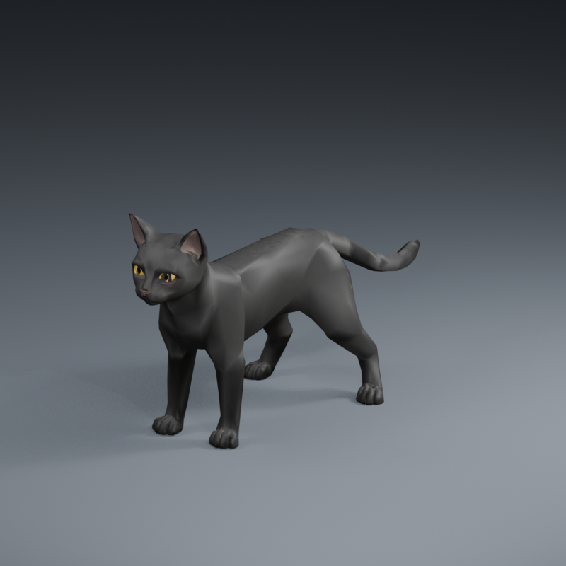

# Sable: original black cat and animation pack



[Open the self-contained GLB](sable.glb) · [Editable Blender scene](sable.blend) · [Asset manifest](asset.json)

Sable is an original stylized cat with four paws, amber eyes and one connected,
tapered tail. Its original image-guided design became a Tripo Pro mesh and coat
texture, then received Blender topology repairs, a fitted original rig and
original animation keys. The earlier procedural design was rejected and replaced.
Copyright 2026 Shoozes; this finished pack is [MIT licensed](../../LICENSE).
The [provenance register](../../docs/dev/ASSET_PROVENANCE.md) records the paid-output
rights evidence. Borrowed fox media and raw generation drafts are not included.

## Try the pack

1. Download `sable.glb` using GitHub's **Download raw file** button, or use the
   file from a source checkout. Open it with RustSMF's folder button.
2. Choose **Animate → Tools → Clips**, select a clip, and press **Play**.
   For **Sit**, pause and scrub to the end to see the held pose.
3. **Save Project** retains editable model/clip state and playback selection.

Current source builds: choose **Export → Tools → Export queue**, select **GLB**,
enable **Include all clips**, then **Add** and **Export queued**. The public
0.2.1 preview has its existing GLB export and no queue; Signal Robot remains its
included sample. This pack does not replace the installer.

The viewport repeats all clips. The **Loop** authoring flag is SMF metadata;
GLB has no standard playback-loop flag. Intended playback is recorded below,
in the manifest and in Blender action/glTF extras for receiving tools.

| Clip | Duration | Playback | Motion |
| --- | --- | --- | --- |
| Idle | 3.0 s | Loop | Breathing, head and tail motion; planted paws |
| Walk | 1.2 s | Loop | In-place four-beat gait |
| Run | 0.8 s | Loop | In-place paired gallop |
| Sit | 2.0 s | Once | Lower into a sit; hold from 1.6 s |

Walk and Run have no forward root travel. A receiving application can move its
root along +Z by approximately **0.1273 m per Walk cycle** or **0.3375 m per Run
cycle** to match the authored stance travel. These are stylized demonstration
motions; a game receiver still needs its own contact, terrain and timing checks.
Run reserves 0.3 mm of paw clearance to avoid inter-key sole penetration while
retaining its root motion and stride. All baked keys and their midpoints are
checked against the same 0.1 mm floor tolerance.

## Rig and geometry

The GLB uses meters, +Y up and +Z forward. Standing height is approximately
0.54 m. The Blender authoring scene uses +Z up and -Y forward, with the rig scaled
to 0.3 meters per authoring unit. There are 24 deform joints:

```text
Root
└─ Pelvis
   ├─ Spine → Neck → Head
   │  ├─ ForeUpper_L → ForeLower_L → ForePaw_L
   │  └─ ForeUpper_R → ForeLower_R → ForePaw_R
   ├─ HindUpper_L → HindLower_L → HindFoot_L → HindPaw_L
   ├─ HindUpper_R → HindLower_R → HindFoot_R → HindPaw_R
   └─ Tail01 → Tail02 → Tail03 → Tail04 → Tail05
```

The foreleg chains branch from **Spine**. All keys are baked at 30 fps with
linear interpolation. The Blender file opens at the neutral standing pose;
its four retained actions can be selected in the Action Editor. No control
rig, constraints, lights, floor or camera are exported.

- Main body: **4,249 vertices / 8,498 triangles**, one connected closed surface.
  The legs, ears and tail connect to that surface.
- Complete mesh: **4,721 vertices / 9,434 triangles**, three closed components.
  The two separate eye surfaces attach to Head.
- Raw Blender and distance-welded body checks both find zero boundary or
  non-manifold edges. GLB vertex counts are higher because UV/material seams
  split vertices; an indexed seam is not an open anatomical boundary.
- One material and a preserved UV atlas with an embedded **1024×1024 PNG**.
  The Blender texture is packed, with no external dependencies. Charcoal fur
  retains subtle highlights under the subdued review lights. The compact atlas keeps this sample
  within the browser's local recovery quota; the original 2K draft stays private.
- Up to four normalized skin influences per vertex. Soles are fully paw-weighted.
  The shoulders and hips use a compact deform rig; large new poses may need
  further weight and topology work in Blender.

[sable.retarget-profile.json](sable.retarget-profile.json) is an explicit
24-joint **mapping example**, with no coordinate/direction correction. Import it
through **Animate → Transfer → Mapping details → Profile** when using a Sable
source. Preview Idle/Walk/Run before Apply; new `Sable_Transfer_*` names preserve
the original clips. Sit is deliberately excluded: its authored non-root
translations and scale are not retained by this profile. The current transfer
solver moves root/rotations; this example is not a lossless same-rig clip copier.
Use GLB export with all clips to preserve the authored pack exactly. For another
rig, review mapping, rest frames and proportions first; this profile establishes
no fox or other animal compatibility.

## Rebuild and inspect

Use Blender **5.2 LTS** from the repository root; this candidate was made with
5.2.1. The editable `.blend` owns the finished geometry and packed texture. Save
geometry edits there, then rebuild the rig, weights and original keys with the
recipe. Start with a **separate output folder** to preserve your edited master:

```powershell
& 'C:\Program Files\Blender Foundation\Blender 5.2\blender.exe' --background --factory-startup --python-exit-code 1 --python examples/black-cat/build_black_cat.py -- --source-blend examples/black-cat/sable.blend --output-dir output/sable-rebuild
```

The recipe writes `.blend`, `.glb` and `asset.json` in the output folder. It
replaces weights/actions there; only the input scene's geometry, UVs and packed
texture are retained. Omit `--output-dir` only when deliberately replacing the
sample after backing up manual rig or animation edits.

Add `--render --review-dir output/sable-review` for fixed-camera front, left,
right and rear images at rest, Walk/Run lift, mid-Sit and held Sit, five
three-quarter views, and native evaluated-mesh floor/paw samples at every key
and midpoint. Review output stays local.
`asset.json` binds the generator and output bytes by SHA-256; Blender output is
not promised byte-identical across versions. `--source-blend` accepts a copy of
the editable scene and `--output-dir` can preserve the original. The recipe
does not require the private Tripo draft or borrowed reference. `.blend` retains
editable geometry, UVs, packed texture, weights and actions.

The raw GLB unit checks independently inspect hierarchy, UVs, influences, floor
clearance, known root motion, gait lift, full rotation/scale/skinned loop seams
and the held Sit ending. Deliberately damaged terminal and interior keys must fail.
An alternate-output Blender rebuild passes the same independent continuity
checks; this does not promise identical Blender file bytes. The
browser and product journey check ordinary Open/playback, project continuation
and independently sampled queued GLB roundtrip. See the
[test inventory](../../source/frontend/tests/README.md).

---
AI-created: 2026-10-15 | agent=Codex/root | model=unknown | effort=unknown | task=original-assets

AI-edited: 2026-10-15T17:05:37.137Z | agent=Codex/root | model=unknown | effort=unknown | task=original-assets | change=added original Sable pack and acceptance routes
