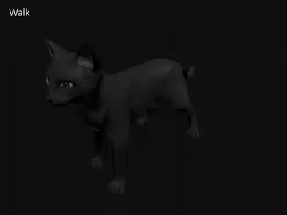

# Sable: original black cat and animation pack

[](../../docs/images/sable-idle.webm)

WebM · [Idle](../../docs/images/sable-idle.webm) · [Walk](../../docs/images/sable-walk.webm) · [Run](../../docs/images/sable-run.webm) · [Sit](../../docs/images/sable-sit.webm) · 2.4 seconds each.

[Open the self-contained GLB](sable.glb) · [Asset details](asset.json)

A cat with a rig, texture and four animation clips.
[MIT licensed](../../LICENSE), copyright 2026 Shoozes.

## Try the pack

1. Download [`sable.glb`](sable.glb) with **Download raw file**.
2. Open it in RustSMF. Choose **Animate → Tools → Clips**, select a clip, then **Play**.
3. Use **Save Project** to keep edits.

For **Sit**, pause and scrub to the end to see the held pose.

### Export all clips — source builds

1. Open **Export → Tools → Export queue**.
2. Choose **GLB** and enable **Include all clips**.
3. Select **Add**, then **Export queued**.

The 0.2.1 preview uses its existing GLB export and has no queue. Its included
sample is Signal Robot.

Playback repeats every clip. Sit is authored to play once, then hold.

| Clip | Duration | Playback | Motion |
| --- | --- | --- | --- |
| Idle | 3.0 s | Loop | Breathing, head and tail motion; planted paws |
| Walk | 1.2 s | Loop | In-place four-beat gait |
| Run | 0.8 s | Loop | In-place paired gallop |
| Sit | 2.0 s | Once | Lower into a sit; hold from 1.6 s |

<details>
<summary>Rig, motion and transfer details</summary>

GLB has no standard playback-loop flag. Intended playback is recorded in the
manifest and animation metadata. The Loop authoring flag is SMF metadata.

Walk and Run have no forward root travel. A receiving application can move its
root along +Z by approximately **0.1273 m per Walk cycle** or **0.3375 m per Run
cycle** to match the authored stance travel. These are stylized demonstration
motions; a game receiver still needs its own contact, terrain and timing checks.
Run reserves 0.3 mm of paw clearance to avoid inter-key sole penetration while
retaining its root motion and stride. All baked keys and their midpoints are
checked against the same 0.1 mm floor tolerance.

## Rig and geometry

The GLB uses meters, +Y up and +Z forward. Standing height is approximately
0.54 m. There are 24 deform joints:

```text
Root
└─ Pelvis
   ├─ Spine → Neck → Head
   │  ├─ ForeUpper_L → ForeLower_L → ForePaw_L
   │  └─ ForeUpper_R → ForeLower_R → ForePaw_R
   ├─ HindUpper_L → HindLower_L → HindFoot_L → HindPaw_L
   ├─ HindUpper_R → HindLower_R → HindFoot_R → HindPaw_R
   └─ Tail01 → Tail02 → Tail03 → Tail04 → Tail05
```

The foreleg chains branch from **Spine**. All keys are baked at 30 fps with
linear interpolation. No control rig, constraints, lights, floor or camera are
exported.

- Main body: **4,249 vertices / 8,498 triangles**, one connected closed surface.
  The legs, ears and tail connect to that surface.
- Complete mesh: **4,721 vertices / 9,434 triangles**, three closed components.
  The two separate eye surfaces attach to Head.
- Authoring-mesh and distance-welded body checks both find zero boundary or
  non-manifold edges. GLB vertex counts are higher because UV/material seams
  split vertices; an indexed seam is not an open anatomical boundary.
- One material and a preserved UV atlas with an embedded **1024×1024 PNG**.
  No external textures are needed. Charcoal fur
  retains subtle highlights under the subdued review lights. The compact atlas keeps this sample
  within the browser's local recovery quota; the original 2K draft stays private.
- Up to four normalized skin influences per vertex. Soles are fully paw-weighted.
  Large new poses are outside this pack's verified range; review shoulder and
  hip deformation.

[sable.retarget-profile.json](sable.retarget-profile.json) is an explicit
24-joint **mapping example**, with no coordinate/direction correction. Import it
through **Animate → Transfer → Mapping details → Profile** when using a Sable
source. Preview Idle/Walk/Run before Apply; new `Sable_Transfer_*` names preserve
the original clips. Sit is deliberately excluded: its authored non-root
translations and scale are not retained by this profile. The current transfer
solver moves root/rotations; this example is not a lossless same-rig clip copier.
Use GLB export with all clips to preserve the authored pack exactly. For another
rig, review mapping, rest frames and proportions first; this profile establishes
no fox or other animal compatibility.

</details>

## Contributor notes

[Optional authoring notes](../../docs/dev/SABLE_AUTHORING.md) ·
[Asset provenance](../../docs/dev/ASSET_PROVENANCE.md).
Borrowed references and raw drafts are not included.

<!--
AI-created: 2026-10-15 | agent=Codex/root | model=unknown | effort=unknown | task=original-assets
AI-edited: 2026-10-15T17:05:37.137Z | agent=Codex/root | model=unknown | effort=unknown | task=original-assets | change=added original Sable pack and acceptance routes
AI-edited: 2026-10-16T16:21:33.101Z | agent=Codex/root | model=unknown | effort=unknown | task=standalone-product-guidance | change=kept user workflows self-contained and routed optional sample authoring to developer notes
AI-edited: 2026-10-16T16:31:34.044Z | agent=Codex/root | model=unknown | effort=unknown | task=concise-user-copy | change=shortened instructions and kept metadata out of rendered guidance
AI-edited: 2026-10-16 | agent=Codex/root | model=unknown | effort=unknown | task=animal-chain-assistance | change=showed all four Sable clips
-->
